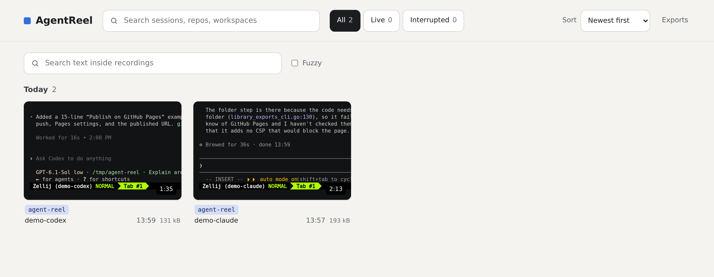
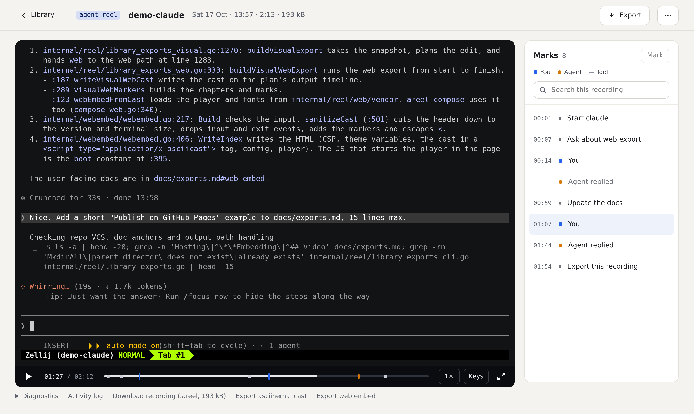

# AgentReel

**Record your terminal sessions, agents and all, and play them back as
searchable, selectable text.**

`areel` records whole Zellij sessions into a private local library. Browse
them in a web UI, jump between marks your agents leave, search everything
that was ever on screen, and export a clip as a video or an interactive web
page.

<a href="https://self-deprecated.github.io/agent-reel/demo/">
  
</a>

▶ **[Play the demo](https://self-deprecated.github.io/agent-reel/demo/)**:
the same recording as a web export. Select the text, click a chapter, scrub.
It's one HTML file with no server.

| The library | A recording |
|---|---|
|  |  |

## Install

```sh
brew install --cask self-deprecated/tap/agent-reel   # macOS; brings Zellij and asciinema
```

- **Linux and macOS**: archives on the [releases
  page](https://github.com/self-deprecated/agent-reel/releases). Put `areel`
  and `areel-avt-checkpoint` on your PATH, and install
  [Zellij](https://zellij.dev) and asciinema 3.2.1.
- **Nix**: use the flake (`packages.<system>.areel`) or the [Home Manager
  module](docs/configuration.md#home-manager).

`areel doctor` checks that everything is in place.

## Quick start

Inside a Zellij session:

```sh
areel record                # start recording this session
areel mark "tests green"    # name a moment (agents can do this too)
areel stop                  # finish; the recording is sealed into the library
areel open --browser        # browse it
```

Then share a piece of it:

```sh
areel export latest demo.html --format web --single-file --redact secrets,homepaths
```

## Everyday commands

| | |
|---|---|
| `areel record` · `pause` · `resume` · `stop` | control the recording of this session |
| `areel status` · `areel ls` | what's recording |
| `areel mark [LABEL]` · `areel marks REC` | add and list marks |
| `areel open` | the library web UI |
| `areel search TEXT [REC]` | find text that was on screen |
| `areel export REC [OUT]` | cast, MP4/MOV or web page |
| `areel compose EDL` | edit several clips into one video |
| `areel attach SESSION` | `zellij attach` that also captures keystrokes |
| `areel doctor [REC]` · `areel recover REC` | check prerequisites; repair a recording |
| `areel config` | effective settings and where they came from |

`REC` is a recording ID or prefix, `@` (this session's) or `latest`. Run
`areel help COMMAND` for flags and examples.

## Guides

- [Recording](docs/recording.md): sessions, pauses, sealing, recovery, keystrokes
- [The library](docs/library.md): the web UI, search, colours, remote access
- [Marks and agents](docs/marks-and-agents.md): marks, Claude Code, Codex, OpenCode and Pi hooks
- [Exports](docs/exports.md): casts, video, web embeds, redaction
- [Composing videos](docs/compose.md): EDLs with cuts, cards, overlays and layouts
- [Configuration](docs/configuration.md): settings, Home Manager, services
- [Niri highlights](docs/niri.md): borders on recorded windows
- [Integrations](docs/integrations.md): activity, links, status feed, supervisor
- [Development](docs/development.md): building and testing

## Privacy

- **Recordings hold everything that was on screen**, secrets included. They
  stay in your library (mode 0700), and nothing is uploaded.
- **The library UI has no login.** Any local process can read it while it
  runs. Use [Tailscale Serve](docs/library.md#remote-access-with-tailscale-serve)
  to reach it remotely.
- **Exports publish terminal text.** `--redact` helps, but review an export
  before you share it. Keystrokes are captured only through `areel attach`
  with `areel keys on`, and never exported.

## License

[MIT](LICENSE). The bundled asciinema player is Apache-2.0 and the fonts
are DejaVu/Bitstream Vera; see `internal/reel/web/NOTICE.txt`.
