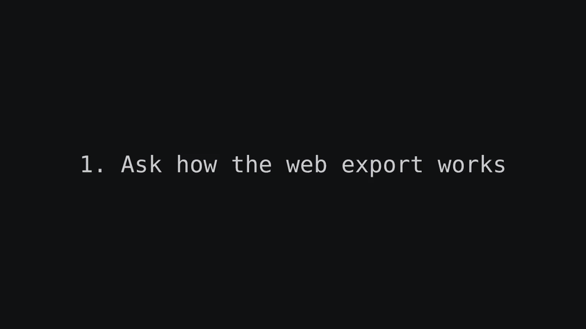

# AgentReel

**A flight recorder for your terminal and the agents working in it.**

`areel` records whole Zellij or tmux sessions in the background, as **text,
not video**. It doesn't capture pixels: it stores every screen as terminal rows,
and a row that repeats is stored once. So a recording stays tiny, and you
can search it, select it and copy from it.

- **Hands-off.** Start it once per session, or let your launcher or Pi start
  it. It keeps recording when you close the terminal or detach, and it
  needs no window or screen capture. Your agents' hooks mark each
  prompt, finished turn and permission request on the timeline by
  themselves.
- **Small.** The two-minute Claude Code session below is a 190 kB file; the
  same footage rendered as 1080p video is 2.8 MB. A busy eight-hour session
  seals to about 10 MB.
- **Sub-agents included.** When an agent's worker runs in its own Zellij
  or tmux session, record that session too and it links itself to the recording
  that spawned it (launchers set `AREEL_PARENT_SESSION`). The library then
  plays the worker next to its parent, in sync. Screenshots and videos can
  be pinned to a moment the same way.
- **Text in, text out.** Search everything that was ever on screen. Export a
  clip as a cast, a video or an interactive web page whose text you can
  still select.

**[▶ Open the live player and select the text yourself](https://self-deprecated.github.io/agent-reel/demo/)**

<a href="https://self-deprecated.github.io/agent-reel/demo/">
  
</a>

A real Claude Code session in this repository, recorded with `areel`. The
agent was asked how the web export works and then to document it. In the
last chapter, a floating Zellij pane exports the recording itself. The
player is one self-contained HTML file. A README can only show it as a GIF,
but the recording is stored as text:

<!-- hero-excerpt:start -->
The agent's answer at 0:58, as text from the recording:

```text
  Where to look, in order:
  1. internal/reel/library_exports_visual.go:1270: buildVisualExport takes the snapshot, plans the edit, and
     hands web to the web path at line 1283.
  2. internal/reel/library_exports_web.go:333: buildVisualWebExport runs the web export from start to finish.
     - :187 writeVisualWebCast writes the cast on the plan's output timeline.
     - :289 visualWebMarkers builds the chapters and marks.
     - :123 webEmbedFromCast loads the player and fonts from internal/reel/web/vendor. areel compose uses it
       too (compose_web.go:340).
  3. internal/webembed/webembed.go:217: Build checks the input. sanitizeCast (:501) cuts the header down to
     the version and terminal size, drops input and exit events, adds the markers and escapes <.
  4. internal/webembed/webembed.go:406: WriteIndex writes the HTML (CSP, theme variables, the cast in a
     <script type="application/x-asciicast"> tag, config, player). The JS that starts the player in the page
     is the boot constant at :395.

  The user-facing docs are in docs/exports.md#web-embed.

✻ Crunched for 33s · done 13:58
```
<!-- hero-excerpt:end -->

| The library | A recording, with your agent's marks |
|---|---|
|  |  |

## Install

```sh
brew install --cask self-deprecated/tap/agent-reel   # macOS; brings Zellij and asciinema
```

- **Linux and macOS**: archives on the [releases
  page](https://github.com/self-deprecated/agent-reel/releases). Put `areel`
  and `areel-avt-checkpoint` on your PATH, and install
  [Zellij](https://zellij.dev) or [tmux](https://github.com/tmux/tmux) 3.2+,
  and asciinema 3.2.1.
- **Nix**: use the flake (`packages.<system>.areel`) or the [Home Manager
  module](docs/configuration.md#home-manager).

`areel doctor` checks that everything is in place.

## Quick start

Inside a Zellij or tmux session:

```sh
areel record                # start recording this session
areel mark "tests green"    # name a moment (agents can do this too)
areel stop                  # finish; the recording is sealed into the library
areel open --browser        # browse it
```

Then share a piece of it:

```sh
areel export latest demo.html --format web --single-file --redact secrets,homepaths
```

## Everyday commands

| | |
|---|---|
| `areel record` · `pause` · `resume` · `stop` | control the recording of this session |
| `areel status` · `areel ls` | what's recording |
| `areel mark [LABEL]` · `areel marks REC` | add and list marks |
| `areel open` | the library web UI |
| `areel search TEXT [REC]` | find text that was on screen |
| `areel export REC [OUT]` | cast, MP4/MOV or web page |
| `areel compose EDL` | edit several clips into one video |
| `areel attach SESSION` | `zellij attach` that also captures keystrokes (Zellij only) |
| `areel doctor [REC]` · `areel recover REC` | check prerequisites; repair a recording |
| `areel config` | effective settings and where they came from |

`REC` is a recording ID or prefix, `@` (this session's) or `latest`. Run
`areel help COMMAND` for flags and examples.

## Guides

- [Recording](docs/recording.md): sessions, pauses, sealing, recovery, keystrokes
- [The library](docs/library.md): the web UI, search, colours, remote access
- [Marks and agents](docs/marks-and-agents.md): marks, Claude Code, Codex, OpenCode and Pi hooks
- [Exports](docs/exports.md): casts, video, web embeds, redaction
- [Composing videos](docs/compose.md): EDLs with cuts, cards, overlays and layouts
- [Configuration](docs/configuration.md): settings, Home Manager, services
- [Niri highlights](docs/niri.md): borders on recorded windows
- [Integrations](docs/integrations.md): activity, links, status feed, supervisor
- [Development](docs/development.md): building and testing

## Privacy

- **Recordings hold everything that was on screen**, secrets included. They
  stay in your library (mode 0700), and nothing is uploaded.
- **The library UI has no login.** Any local process can read it while it
  runs. Use [Tailscale Serve](docs/library.md#remote-access-with-tailscale-serve)
  to reach it remotely.
- **Exports publish terminal text.** `--redact` helps, but review an export
  before you share it. Keystrokes are captured only through `areel attach`
  with `areel keys on`, and never exported.

## License

[MIT](LICENSE). The bundled asciinema player is Apache-2.0 and the fonts
are DejaVu/Bitstream Vera; see `internal/reel/web/NOTICE.txt`.
