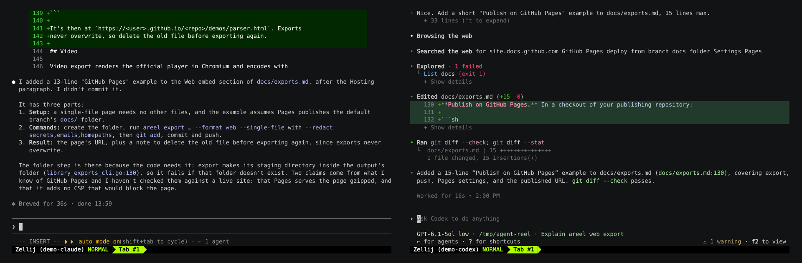

# Composing videos

`areel compose` turns recordings into a finished video. You describe it in an
**EDL** (edit decision list), a JSON file. It holds clips from one or more
recordings, each with its own speed, idle trimming, zoom and colours, plus
title cards, overlays, fades and side-by-side layouts.

The EDL format is easy for agents to write. Every moment is named by a mark,
a time or a search hit, and you can preview everything before rendering.

For a plain cut of one recording with nothing drawn on it, use an [export
recipe](exports.md#picking-a-range) instead.


The GIF above is one: three chapters of a Claude Code session with title
cards, idle pauses trimmed and sped up 3×. Its EDL is in
[`tools/demo-record/visuals.py`](../tools/demo-record/visuals.py).

## Workflow

```sh
areel inspect latest                       # segments, sizes and marks to cut on
$EDITOR talk.edl.json                      # write the EDL
areel compose talk.edl.json --plan         # check it; renders nothing
areel compose talk.edl.json --still s1@2.5 frame.png   # look at one frame
areel compose talk.edl.json --proxy draft.mp4          # quick 640px, 2fps draft
areel compose talk.edl.json --freeze talk.frozen.json  # pin every moment
areel compose talk.frozen.json talk.mp4                # render
areel compose talk.frozen.json talk.html --web         # or an interactive web page
```

Rendering needs Chromium and FFmpeg, as [video export](exports.md#video)
does. `--plan` and `--freeze` need neither.

A **frozen** EDL has every mark and search resolved to exact times, and
every sealed source pinned by digest. Re-rendering it later gives the same
frames.

## Example

```json
{
  "schema": "agent-reel/edl/1",
  "output": {"width": 1920, "height": 1080, "rate": {"num": 30, "den": 1}},
  "defaults": {"theme": "dracula", "idle": {"threshold": "3s", "keep": "0.8s"}},
  "sources": {"main": {"recording": "latest"}},
  "segments": [
    {"id": "intro", "kind": "card", "duration": "3s",
     "title": "Refactoring the parser", "subtitle": "ten minutes in one",
     "in": {"type": "fade", "duration": "0.5s"}},
    {"id": "refactor", "source": "main", "title": "Refactor",
     "from": {"mark": "start-refactor", "offset": "-2s"}, "to": {"mark": "tests-green"},
     "speed": {"num": 8, "den": 1},
     "overlays": [{"type": "chapter", "text": "Refactor at 8×", "for": "4s"}]},
    {"id": "green", "source": "main", "title": "Tests pass",
     "from": {"mark": "tests-green", "offset": "-3s"}, "duration": "8",
     "view": {"cells": {"x": 0, "y": 34, "cols": 100, "rows": 16}},
     "overlays": [{"type": "title", "text": "All tests green", "at": "5s"}],
     "out": {"type": "fade", "duration": "1s"}}
  ]
}
```

The two marks came from `areel mark "start-refactor"` and
`areel mark "tests-green"` during the session.

## The document

One JSON object of at most 64 KiB. Unknown or misspelled fields are refused
with their position.

| Field | |
|---|---|
| `schema` | `"agent-reel/edl/1"` |
| `output` | `width` × `height` (even, up to 1920×1080; default 1280×720), `rate` (`{num, den}`, default 30 fps), `codec` `h264` or `prores` |
| `defaults` | `theme`, `cursor` (`steady`/`hidden`), `idle`, `minFontPx` (default 10), `paddingPx`, applied to every segment that doesn't set its own |
| `sources` | up to 8 named recordings: `{"recording": "latest"}` (an ID, prefix or `latest`), or `{"link": "main:worker"}` for a [linked](integrations.md#links) sub-recording, screenshot or video |
| `redact` | masking rules, [below](#redaction) |
| `segments` | 1–64 segments, rendered in order |

### Segments

**Clips** play a span of one source:

| Field | |
|---|---|
| `source` | a source name |
| `from`, `to` | [timerefs](#timerefs). `from` defaults to the segment start; `to` can be replaced by `duration` (source seconds) or left out (to the end). Both ends must be in the same recording segment. |
| `speed` | `{"num": 4, "den": 1}`, from 1/16× to 64× |
| `idle` | `{"threshold": "2s", "keep": "0.5s"}`: every pause longer than the threshold is cut to `keep`; `{"off": true}` disables a default |
| `view` | `{"fit": true}` (whole terminal) or `{"cells": {x, y, cols, rows}}` to zoom in on part of it |
| `theme` | colours for this segment, e.g. `"nord"` |
| `title` | the chapter name |
| `overlays` | up to 32, [below](#overlays) |
| `in`, `out` | `{"type": "cut"}`, `{"type": "fade", "duration": "0.4s"}` or (in only) `{"type": "dissolve", "duration": "0.5s"}` |

**Cards** (`"kind": "card"`) are a title and subtitle on the theme's
background, for up to 60 s of `duration`.

**Layouts** (`"kind": "layout"`) show 2–4 sources at once:

```json
{"id": "race", "kind": "layout", "layout": "side-by-side",
 "clock": "claude", "from": "0", "duration": "90", "speed": {"num": 2, "den": 1},
 "slots": [{"source": "claude"},
           {"source": "codex", "from": "0"},
           {"source": "pi", "from": "0"}]}
```



- `side-by-side`: equal columns for 2 or 3 slots, a 2×2 grid for 4.
- `pip`: the first slot fills the frame and the others are insets.
- Every slot plays the same length of its own source. Linked sources line
  up through their links; give any other slot its own `from`.
- Small slots usually need a `cells` view, or a lower `minFontPx`, to stay
  legible.

### Timerefs

| Form | Means |
|---|---|
| `"12.5"` | 12.5 s into segment 1 |
| `{"segment": 2, "at": "12.5"}` | 12.5 s into segment 2 |
| `{"mark": "tests-green"}` | the labelled mark with exactly that label |
| `{"mark": {"seq": 123}}` | any mark by its sequence number (`areel inspect` lists them) |
| `{"search": "PASS", "nth": 1}` | the first appearance of the nth distinct line containing the text (sealed sources only) |
| `{"parent": …}` | on a link source: a timeref on the parent, mapped onto the link |

Add `"offset": "-2s"` to any object form to shift it. Times are decimal
seconds, optionally with `s`.

### Overlays

| `type` | Draws |
|---|---|
| `title` | big centred `text`, optional `subtitle` |
| `chapter` | a lower-third bar |
| `callout` | a boxed note under an `anchor`: `{"cell": {x, y}}` or `{"px": {x, y}}` |
| `keys` | the [keystrokes](recording.md#keystrokes-areel-attach) typed during the clip |

`at` and `for` are on the segment's output clock (after speed and idle).

### Keys overlay

```json
{"type": "keys", "at": "2s", "for": "6s", "position": "bottom-right"}
```

This draws the keys typed during the clip as chips: masked input as `•••`,
a paste as `⎘ N chars`, each client in its own colour. `client` keeps only
one client's keys. Keys appear only where an EDL asks for them; never in
exports or web pages.

## Redaction

```json
"redact": [{"preset": "secrets"}, {"preset": "homepaths"},
           {"pattern": "acme-[a-z]+", "replace": "█"}]
```

or `areel compose talk.edl.json --redact secrets,emails`.

- **`secrets`**:
  - API keys and tokens: OpenAI/Anthropic `sk-…`, Stripe, GitHub, GitLab,
    AWS, Slack, Google, npm, PyPI and JWTs.
  - `Bearer`/`Basic` credentials and cookie values.
  - Passwords in URLs, `docker login -p`, `mysql -p` and `curl -u`.
  - PEM key bodies.
  - `KEY=value` pairs whose key names a secret: `api_key`, `token`,
    `password`, `apiKey` and the like.
  - It avoids look-alikes such as `keyboard`, `tokenizer`, placeholders
    (`${TOKEN}`), paths and code identifiers.
- **`emails`**: e-mail addresses. `git@host:` remotes, `user@localhost` and
  `pkg@1.2.3` are left alone.
- **`homepaths`**: `/home/<user>` and `/Users/<user>` become `~`.
- **`pattern`**: any RE2 regular expression. A named group `(?P<secret>…)`
  masks only that group.

**Not caught:**

- a secret wrapped over two terminal lines;
- passwords under 6 characters;
- secrets under names the presets don't know (use a `pattern` for these);
- secrets in prose;
- mark labels, overlay text, and the library viewer itself.

`--plan` reports how many rows each rule masks, with masked examples. A
frozen EDL contains your `pattern`s verbatim, so don't publish it.

## Web output

`--web OUT.zip` or `OUT.html` builds the same offline player page as
[`export --format web`](exports.md#web-embed). The composition plays as
one terminal, so a few things don't carry over:

- layouts aren't supported;
- overlays, zoom and fades are skipped, each with a warning;
- the page uses the first segment's colours throughout.

## Common errors

| Message | Fix |
|---|---|
| `a clip cannot cross a recording segment` | split it at the pause into two segments |
| `to … exceeds … durable coverage end` | end earlier (see `coverageEnd` in `areel inspect`) |
| `mark "x": no match; labels in the source: […]` | fix the label |
| `mark "x" matches 2 marks` | use `{"mark": {"seq": N}}` |
| `{"search":…} needs the text index` | stop (seal) the recording first, or use a time or mark |
| `cells view text 7.9 px is below the 10 px minimum` | zoom to fewer cells, render larger, or lower `minFontPx` |
| `… is not linked to the clock …; give the slot a from` | set `from` on that slot |
