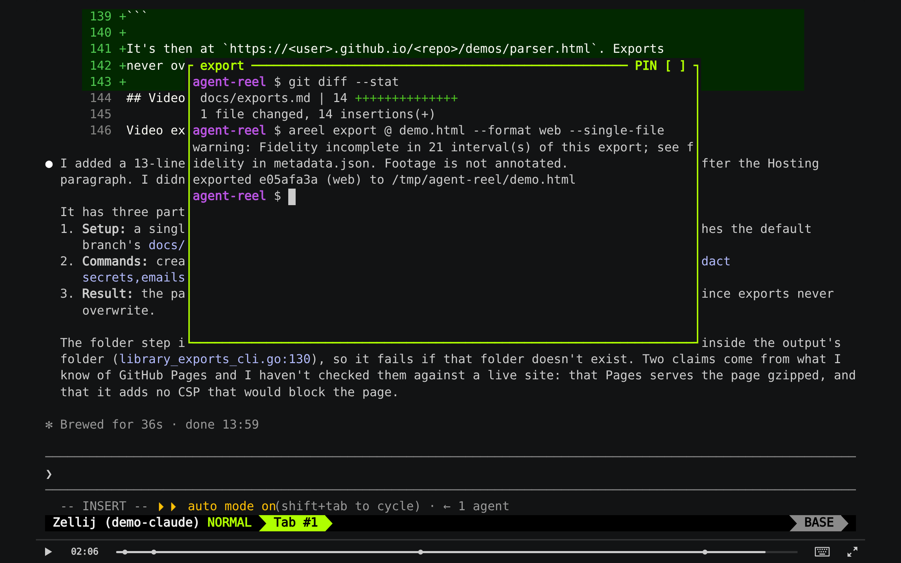

# Exports

```sh
areel export latest                          # asciinema casts in a ZIP
areel export latest talk.mp4 --format h264   # a video
areel export latest demo.html --format web --single-file   # an interactive web page
```

Exports never pause or change the recording, so you can export a live one.
You get everything saved up to that moment.

| Format | You get |
|---|---|
| `cast` (default) | a ZIP of asciinema `.cast` files, one per clip, with marks as `"m"` events |
| `h264` / `prores` | an MP4 or MOV, plus the render input and a markers file for editors |
| `web` | a self-contained player page with selectable text and chapters ([below](#web-embed)) |

The output must be a new file outside the library; nothing is overwritten.
By default it's `<short-id>-<YYYYMMDD-HHMM>.zip` in `export.directory` or
the current directory. The viewer's **Export** button opens the same
options as a form and runs the job in the background.

## Picking a range

```sh
areel export latest --from 1:30 --to 4:00    # footage time; pauses don't count
areel export latest --segment 2              # one segment
areel export latest --recipe cuts.json       # several clips, each with its own speed
areel export latest --recipe cuts.json --plan   # preview the edit, write nothing
```

A **recipe** (`agent-reel/recipe/1`) lists clips:

```json
{
  "schema": "agent-reel/recipe/1",
  "clips": [
    {"segment": 1, "start": "12", "end": "48.5", "title": "Setup"},
    {"segment": 1, "start": "120", "end": "300", "speed": {"num": 4, "den": 1}, "title": "Build"}
  ]
}
```

| Field | |
|---|---|
| `clips` | `{segment, start, end, speed, title}`. Times are decimal-second strings; omit `start`/`end` for the whole segment, and `speed` is `{num, den}` |
| `rate` | video frame rate, `{num, den}`: 1–60, or 24000/1001, 30000/1001, 60000/1001 |
| `output` | video `{width, height}` |
| `framing` | `{mode: "fit"\|"font", fontPx, paddingPx, minFontPx}` |
| `cursor` | `steady` or `hidden` |
| `theme` | colours, e.g. `"dracula"` |
| `includeClipCasts` | also put clip casts in a video ZIP |

Omitted fields take the command's flags. Recipes are at most 64 KiB and 256
clips. Each clip becomes a chapter. For title cards, overlays, zoom, fades or
several recordings side by side, use [`areel compose`](compose.md) instead.

## Redaction

```sh
areel export latest demo.html --format web --single-file \
  --redact secrets,emails,homepaths
```

| Preset | Masks |
|---|---|
| `secrets` | API keys and tokens (`sk-…`, `ghp_…`, AWS, Slack, JWTs, …), `password=`/`token=` values, credentials in URLs and common CLI flags |
| `emails` | e-mail addresses |
| `homepaths` | `/home/<user>` and `/Users/<user>`, shown as `~` |

Matching cells become `█` (or `~`). The recording itself isn't changed.
Redaction can miss things: secrets wrapped across two lines, unusual names,
mark labels. **Review an export before you publish it.** See
[compose: redaction](compose.md#redaction) for exactly what each preset
covers.

## Web embed

```sh
areel export latest demo.html --format web --single-file \
  --title "Fixing the parser" --idle-limit 2 --redact secrets,homepaths
```



This makes one HTML file that plays the recording in the asciinema player.
The terminal is real text you can select and copy. It works offline: from
`file://`, any static host or an iframe, and it makes no network requests.
Without `--single-file` you get a ZIP with `index.html` and an `assets/`
folder.

**Chapters and marks.** Each recipe clip with a title becomes a chapter. So
does each labelled mark (`areel mark`, Pi `/reel mark`, a hook's `mark`
event). Click one on the timeline, or press `[` and `]` to step between
them. Automatic agent marks (You/Agent, tool activity) are left out.

**What's published:** the terminal text, chapter titles and mark labels.
Recording IDs, session and host names, paths and activity details are left
out. The cast header is reduced to the terminal size.

| Option | Default | |
|---|---|---|
| `--title TEXT` | "Terminal recording" | page title |
| `--idle-limit S` | none | cap every pause at S seconds |
| `--speed X` | 1 | playback speed, 0.1–16 |
| `--poster npt:TIME` | first frame | still shown before play |
| `--markers` | `chapters,marks` | or `chapters`, `marks`, `none` |
| `--theme SPEC` | `ui.theme` | colours, e.g. `dracula` |
| `--controls` | `auto` | `always`, `never` |
| `--autoplay`, `--loop` | off | |
| `--fit` | `both` | `width`, `height`, `none` |

**Embedding** in another page:

```html
<iframe src="/demos/fixing-the-parser.html" width="960" height="560"
        style="border:0;max-width:100%" title="Terminal recording"
        loading="lazy" allowfullscreen></iframe>
```

Inside the frame, `window.agentReelPlayer` has `play()`, `pause()`,
`seek(…)`, `getCurrentTime()` and `addEventListener(…)`;
`seek({marker: 2})` jumps to a chapter.

**Hosting.** Serve it compressed. Terminal text compresses 25–65× (an hour
is about 0.5 MB gzipped). The page sets its own Content-Security-Policy. If
your site adds one, allow `'unsafe-inline'` scripts and styles, `data:` fonts
and `'wasm-unsafe-eval'` (the player's terminal engine is WebAssembly).

## Video

Video export renders the official player in Chromium and encodes with
FFmpeg. Both must be available: the Nix `areel-video` package, or
`AREEL_EXPORT_CHROMIUM`, `AREEL_EXPORT_FFMPEG` and `AREEL_EXPORT_FFPROBE`.
`areel doctor` shows what it found.

```sh
areel export latest talk.mp4 --format h264 --fps 30 --size 1920x1080
```

- **Size**: `1280x720` by default. Terminal text must be at least 10 px, so
  a wide terminal needs a larger size; the error says which.
- **Frame rate**: 1–60 fps.
- **Limits**: 108,000 frames and 1 GiB.
- **Ctrl-C** cancels and cleans up.
- **Defaults**: set them with `export.format`, `export.fps`, `export.size`
  and `export.directory` (see [configuration](configuration.md)).
